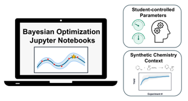

# Bayesian Reaction Pptimization


***

Interactive Python notebooks introducing Bayesian optimization (BO) for chemistry. Explore published reaction datasets and compare optimization strategies against fitted surrogate experiments (“oracles”).

Authors: Kaiman A. Cheung, Daniel Wigh, Alexander Pomberger, and Michael J. Tilby.

## Getting started

Use Python 3.12. From this folder:

```bash
python -m venv .venv
```

Activate the environment:

- Windows PowerShell: `.venv\Scripts\Activate.ps1`
- macOS/Linux: `source .venv/bin/activate`

Then install and start JupyterLab:

```bash
python -m pip install -r requirements.txt
python -m jupyter lab
```

Open the notebooks from this folder so that relative paths to `data/` and `scripts/` work. Choose the environment's Python kernel. No credentials, external services, or data downloads are needed to run the supplied examples.

## Notebook order

| Notebook | Purpose |
| --- | --- |
| 0 — BO glossary | Terminology and configuration names |
| 1 — Introduction to BO | A one-dimensional example of surrogate fitting and acquisition |
| 2 — Handling chemistry data | Inspect conditions, outcomes, and categorical variables |
| 3 — Constructing an oracle | Fit and query reaction models; optionally add a custom dataset |
| 4 — Defining a BO problem | Configure and run a worked optimization campaign |
| 5 — Optimization workbook | Compare configurations on a chosen reaction dataset |

Run each notebook from top to bottom with the defaults before changing settings. Notebooks 2 and 4 use Jensen case IV; notebook 5 defaults to the numeric Olympus dataset. Oracle models are fitted when loaded, so initial execution and repeated campaigns can take several minutes. Notebook 3's custom-oracle exercise is optional.

These are teaching materials. “Group” activities can also be completed individually.

## Data and licensing

The nine supplied datasets, source citations, transformations, and reuse information are listed in [data/README.md](data/README.md) and [data/dataset_summary.csv](data/dataset_summary.csv).

The notebooks are MIT-licensed; this license excludes all datasets. Third-party dataset terms and attributions are listed separately in [LICENSE](LICENSE).
